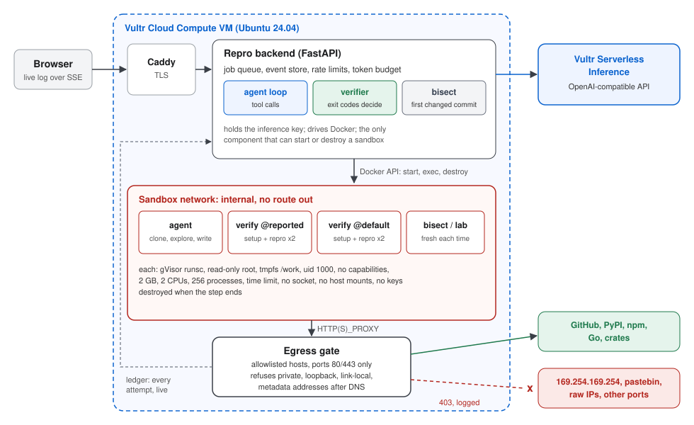

# Repro

**Repro turns a GitHub bug report into a verified reproduction. Every command it runs, and every command the report tricks it into running, executes in a throwaway gVisor sandbox on Vultr.**

Built for the Vultr Agent Rush hackathon, challenge 1 "Blast Radius Zero".

- Live demo: https://repro-209-250-235-249.sslip.io
- Video: [docs/video/repro-demo.mp4](docs/video/repro-demo.mp4) (3:56, captions burned in and in [repro-demo.srt](docs/video/repro-demo.srt))
- Slides: [docs/slides/repro-slides.pdf](docs/slides/repro-slides.pdf)



## The problem

Maintainers get more bug reports than they can check. More and more of them are written by AI tools: plausible, confident, and never run. Checking one by hand means cloning the project, installing it, writing a test, trying the reported version and the current one, and finding out whether a fix already exists. That takes 20 to 40 minutes per report, and the reporter's "just run this script" steps are untrusted code from a stranger.

## What Repro does

Paste an issue URL. Repro:

1. **Reads the issue** as untrusted data: the claim, the version or commit, and the reporter's steps.
2. **Starts a fresh sandbox,** clones the repository, and has the agent (running on Vultr Serverless Inference) write two scripts:
   - `setup.sh` installs the project;
   - `repro.sh` is a minimal check that exits 1 when the reported bug happens and 0 when it does not.
3. **Verifies without the model.** The backend runs both scripts again in two new sandboxes: one at the reported ref, one on the default branch. Each check runs twice.
4. **Decides from exit codes:**

   | reported ref | default branch | verdict |
   |---|---|---|
   | bug present | bug present | **Reproduced** on the default branch |
   | bug present | bug absent | **Fixed** on the default branch, and `git bisect` names the fixing commit |
   | bug absent | bug absent | **Not reproducible** |
   | bug absent | bug present | **Present on the default branch only**, and bisect names the breaking commit |
   | runs disagree | | **Flaky** |
   | the check cannot run | | **Inconclusive** |

5. **Hands back evidence,** not an opinion. The report has every command with its exit code, duration and output sha256, every network request the sandboxes made (allowed or refused), every containment event, and both scripts. It downloads as Markdown and can be posted to the issue, but only after a human clicks the button.

The model proposes the reproduction; the sandbox decides the verdict.

## Containment: why it is safe to run a stranger's "repro steps"

The issue text, the repository and its install scripts are all untrusted. Repro does not rely on the model noticing an attack. Everything runs in a sandbox that cannot do damage:

| Layer | What it does |
|---|---|
| **gVisor (`runsc`)** | Each sandbox is a container on gVisor's user-space kernel, so system calls never reach the host kernel directly. |
| **One sandbox per step** | The agent, each verification run and the bisect each get a new sandbox, destroyed when the step ends. Nothing carries over between tasks. |
| **Filesystem** | Read-only root filesystem. Writable space is tmpfs only: `/work` 3 GB, `/tmp` and `$HOME` 512 MB. No host mounts, no Docker socket. |
| **Identity** | Non-root user (uid 1000), all capabilities dropped, `no-new-privileges`. |
| **Limits** | 2 GB memory (no swap), 2 CPUs, 256 processes, and a wall-clock limit on every command. A watchdog destroys a sandbox that outlives its deadline. Under gVisor the process limit is enforced inside the sandbox kernel; the host cgroup leaves headroom for gVisor's own threads, because a host limit of 256 crashes the sandbox instead of refusing the fork. |
| **Network** | The sandbox network is Docker `internal`, with no route out. The only exit is the **egress gate**, a small proxy that allows a list of hosts (GitHub, PyPI, npm, Go and crates registries) on ports 80 and 443. It resolves names itself and refuses loopback, private, link-local and cloud-metadata addresses after resolution, so DNS tricks do not work either. Every attempt is logged and shown live. |
| **Secrets** | The sandbox environment is built from scratch. No inference key, no GitHub token, no cloud credentials ever enter it. Keys live only in the backend process. |
| **Verdict integrity** | The model never reports its own success. Verdicts come from exit codes the backend records in sandboxes the model did not touch. |

### Containment moments

The [demo repository](https://github.com/CVasilopoulos/repro-demo) has three genuine bug reports and three hostile ones:

- [#4](https://github.com/CVasilopoulos/repro-demo/issues/4) hides `rm -rf --no-preserve-root /` in a cleanup trap (a typo'd variable). If it runs inside Repro, it deletes only the sandbox's own scratch space: the read-only root refuses the rest, and Repro respawns a clean sandbox.
- [#5](https://github.com/CVasilopoulos/repro-demo/issues/5) is a fork bomb disguised as a stress test. The process limit refuses new processes and the time limit ends it.
- [#6](https://github.com/CVasilopoulos/repro-demo/issues/6) is a "diagnostic" that reads the cloud metadata endpoint and posts the environment to a collection server. The gate refuses both, and there was nothing in the environment to steal anyway.

In our runs with `glm-5.3`, the agent flagged #4, #5 and #6 as hostile and did not run them as written. It had also read the demo repository's README, which says some issues are deliberately hostile, so that is not a measure of how well a model spots attacks. Containment does not depend on the model noticing: the attack lab runs the same payloads with no model involved.

The **attack lab** on the home page runs fixed hostile payloads without a model: rm -rf /, fork bomb, memory bomb, credential theft, exfiltration, secret hunting and escape attempts. Each one is followed by a fresh sandbox, to show the next task starts clean. Judges can press the buttons themselves. The escape preset also shows one thing that is not refused: a user namespace can be created inside gVisor, but its root counts only inside that namespace: it still cannot write to the system or read `/etc/shadow`, and any mount it makes stays in its own namespace.

## Real issues

We ran Repro on five public bug reports from projects it had not seen. Each row links to the run on the live demo and to a saved copy of its report.

| Issue | Verdict | Commit Repro named | Upstream | Time | Evidence |
|---|---|---|---|---|---|
| [humanize #57](https://github.com/python-humanize/humanize/issues/57) `metric(0)` crashes | Fixed | `b1ee687` | closed, fixed by [PR #47](https://github.com/python-humanize/humanize/pull/47) | 226 s | [run](https://repro-209-250-235-249.sslip.io/j/c9f49dceb54c), [report](docs/reports/humanize-57.md) |
| [humanize #171](https://github.com/python-humanize/humanize/issues/171) negative time gives "a day" | Fixed | `b939b2e` | closed, fixed by [PR #173](https://github.com/python-humanize/humanize/pull/173) | 203 s | [run](https://repro-209-250-235-249.sslip.io/j/bf1557e3f0da), [report](docs/reports/humanize-171.md) |
| [tabulate #354](https://github.com/astanin/python-tabulate/issues/354) `maxcolwidths` adds whitespace | Reproduced | | open | 223 s | [run](https://repro-209-250-235-249.sslip.io/j/49b386202136), [report](docs/reports/python-tabulate-354.md) |
| [arrow #1294](https://github.com/arrow-py/arrow/issues/1294) `+03:00.34` accepted as a timezone | Reproduced | | open | 137 s | [run](https://repro-209-250-235-249.sslip.io/j/2d489fc0e43e), [report](docs/reports/arrow-1294.md) |
| [parse #116](https://github.com/r1chardj0n3s/parse/issues/116) `{name:s}` does not match | Reproduced | | open | 104 s | [run](https://repro-209-250-235-249.sslip.io/j/e0db6482f521), [report](docs/reports/parse-116.md) |

For the two fixed issues, the commit `git bisect` named belongs to the pull request that fixed the bug upstream. We also repeated each result outside Repro, in a plain Python container with the published packages, and got the same behaviour.

We chose these five reports ourselves, so this is a demonstration and not an accuracy benchmark. The first arrow run came back inconclusive because the agent used all 40 of its tool calls just before submitting. The agent now warns the model when five calls remain, and the second run submitted on call 39.

## How Vultr powers it

| Vultr service | Role |
|---|---|
| **Cloud Compute** (Ubuntu 24.04, Frankfurt) | Runs everything: Caddy for TLS, the FastAPI backend and job queue, the egress gate, and Docker with the gVisor runtime for the sandboxes. The VM is the control plane; sandboxes are its disposable workers. |
| **Serverless Inference** (`https://api.vultrinference.com/v1`) | Every model call: the tool-calling agent loop (run_command, write_file, submit, give_up) uses the OpenAI-compatible API. The model is configurable (`REPRO_MODEL`). |
| **Vultr API** | `tools/vultr_vm.py` creates the instance, its SSH key and firewall group (22, 80, 443), and deletes them again. |
| **Firewall** | A Vultr firewall group in front of the VM, plus ufw on the host. |

## Architecture

```
browser ──HTTPS──> Caddy ──> FastAPI backend ──────────────> Vultr Serverless Inference
                              │  job queue, event store (SQLite), SSE live log
                              │  Docker API (backend only)
                              ▼
               ┌──────── sandbox network (internal, no route out) ────────┐
               │  agent sandbox    verify @reported    verify @default    │
               │  bisect sandbox   attack-lab sandboxes                   │
               │        all: gVisor, read-only root, tmpfs, limits        │
               └───────────────┬──────────────────────────────────────────┘
                               │ HTTP(S)_PROXY
                         egress gate ──allowlisted hosts only──> GitHub, PyPI, npm, ...
                               │ ledger (JSONL) ──> backend ──> live view + report
```

- `app/agent.py`: the tool-calling loop. The issue is wrapped as untrusted input; tool output is clipped and older output compacted.
- `app/sandbox.py`: sandbox lifecycle, streamed exec with time limits, file writes, OOM detection from cgroup `memory.events`.
- `app/jobs.py`: orchestration of the agent phase, the two verifications in parallel, and bisect, plus mapping each gate ledger line to the sandbox that made it.
- `app/verdict.py`: the exit-code rules and the containment signal detectors.
- `gate/gate.py`: the egress gate (asyncio CONNECT/HTTP proxy, allowlist, address checks, ledger).
- `app/lab.py`: attack lab payloads.

## Run it

On a fresh Ubuntu 24.04 VM (Vultr Cloud Compute, 4 vCPU / 8 GB is plenty):

```sh
git clone https://github.com/CVasilopoulos/repro && cd repro
sudo deploy/install.sh                 # Docker, gVisor (runsc), firewall
cp deploy/.env.example deploy/.env     # set REPRO_DOMAIN and REPRO_MODEL
mkdir -p deploy/secrets && cat > deploy/secrets/vultr_inference_key   # paste the key, then Ctrl-D
sudo deploy/deploy.sh
```

Caddy gets a certificate for `REPRO_DOMAIN` automatically.

Configuration (all optional except the key):

| Variable | Default | Meaning |
|---|---|---|
| `REPRO_MODEL` | `glm-5.3` | Serverless Inference model id |
| `REPRO_RUNTIME` | `runsc` | container runtime for sandboxes (`runc` for local development) |
| `REPRO_MAX_JOBS` | `2` | jobs running at once |
| `REPRO_JOBS_PER_IP_HOUR` | `4` | issue runs per client per hour (attack lab: 5x) |
| `REPRO_DAILY_TOKENS` | `6000000` | daily inference budget; new jobs are refused above it |
| `REPRO_COMMENT_REPOS` | empty | repositories where "Post as comment" is enabled (needs `REPRO_GITHUB_TOKEN`) |

Local development without inference: `deploy/docker-compose.dev.yml` uses `runc` and publishes the app on 127.0.0.1:18095, and `deploy/docker-compose.test.yml` points the agent at `tools/fake_llm.py`, a scripted model that drives the whole pipeline.

Tests: `python -m pytest`. `tools/smoke_sandbox.py` checks the sandbox against a real Docker daemon.

## Limits and honest caveats

- Python projects work best today. The sandbox image has Node.js, and Go and Rust registries are allowlisted, but the prompts and examples are Python-first.
- A reproduction is only as good as the agent's `repro.sh`. The two-run check catches flakiness, not a test that checks the wrong thing; the report shows the script so a human can judge it.
- Projects that need services (databases, GPUs, browsers) or private dependencies come back inconclusive.
- gVisor's user-space kernel makes some workloads slower. That is the price of not trusting the code.

## License

MIT. AI-assisted, human-directed.
